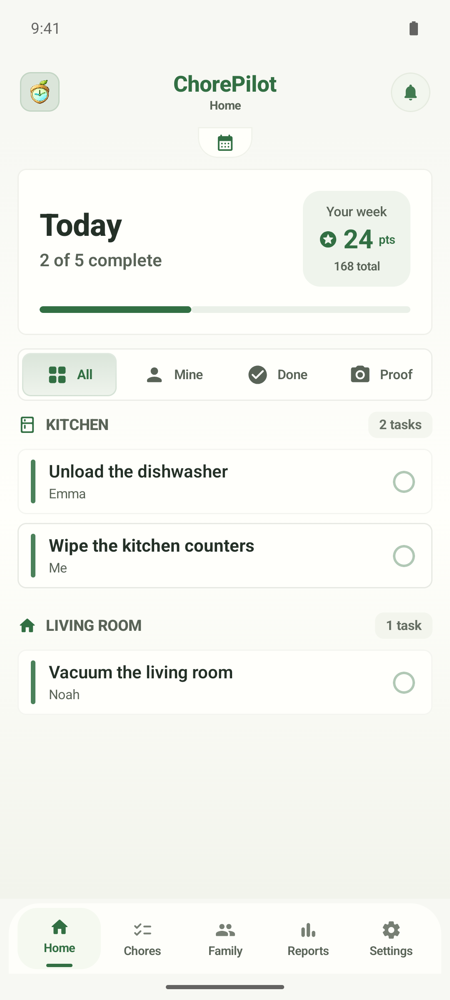
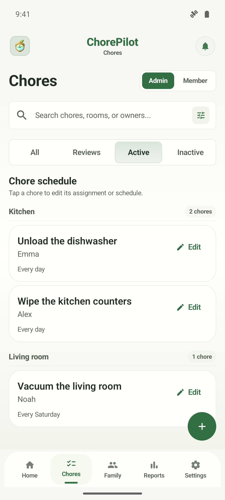
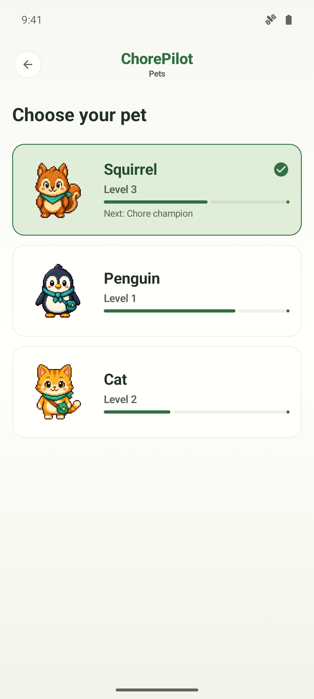
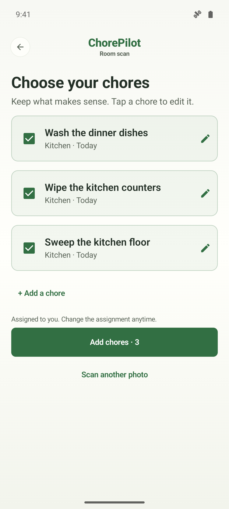
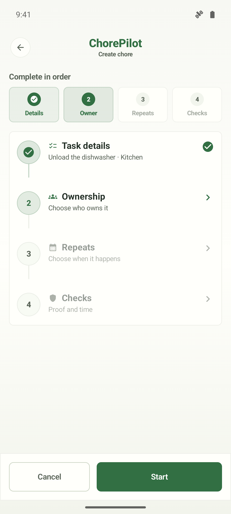
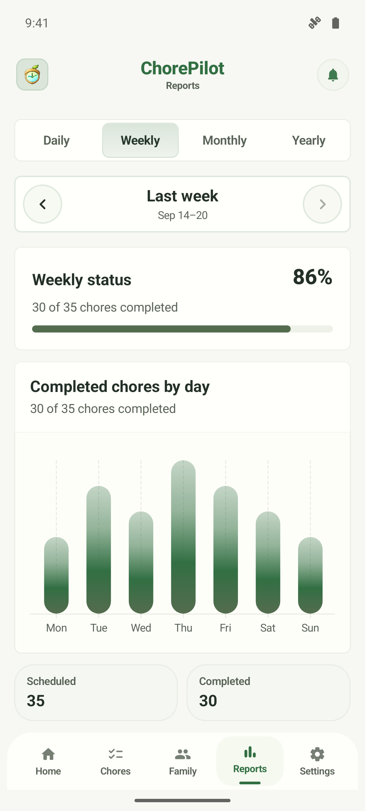
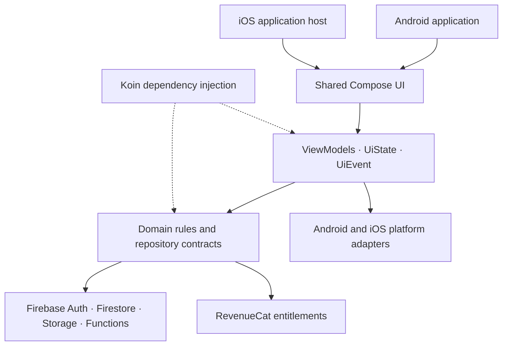

<p align="center">
  
</p>

<h1 align="center">ChorePilot</h1>

<p align="center">
  <strong>A little structure. A lighter home.</strong><br />
  Shared chores, photo proof, and friendly motivation for the people you live with.
</p>

<p align="center">
  Designed and built by <a href="https://github.com/ErickSorto">Erick Sorto</a>.<br />
  One Kotlin Multiplatform codebase for Android and iOS, with shared Compose UI and a Firebase backend.
</p>

<p align="center">
  <a href="https://chorepilotwebsite.vercel.app/"><strong>Product website</strong></a> ·
  <a href="#the-app"><strong>Explore the app</strong></a> ·
  <a href="#engineering"><strong>Explore the code</strong></a> ·
  <a href="#running-locally"><strong>Run locally</strong></a>
</p>

<p align="center">
  
  
  
  
</p>

## The app

Household work is easier to share when everyone can see what needs doing. ChorePilot brings the daily plan, ownership, completion, and progress into one place—with a warm visual language that feels at home.

<table>
  <tr>
    <td align="center" width="33%"><a href="docs/readme/home.webp"></a></td>
    <td align="center" width="33%"><a href="docs/readme/chores.webp"></a></td>
    <td align="center" width="33%"><a href="docs/readme/pets.webp"></a></td>
  </tr>
  <tr>
    <td align="center"><strong>Know what's next</strong><br /><sub>A clear daily plan for the whole household.</sub></td>
    <td align="center"><strong>Share the responsibility</strong><br /><sub>Rooms, routines, and ownership in one view.</sub></td>
    <td align="center"><strong>Make progress feel good</strong><br /><sub>Friendly companions for everyday routines.</sub></td>
  </tr>
</table>

<table>
  <tr>
    <td align="center" width="33%"><a href="docs/readme/scan.webp"></a></td>
    <td align="center" width="33%"><a href="docs/readme/editor.webp"></a></td>
    <td align="center" width="33%"><a href="docs/readme/reports.webp"></a></td>
  </tr>
  <tr>
    <td align="center"><strong>From photo to plan</strong><br /><sub>Review AI-assisted suggestions before saving.</sub></td>
    <td align="center"><strong>Set a useful routine</strong><br /><sub>Give each task context and a clear owner.</sub></td>
    <td align="center"><strong>See the effort add up</strong><br /><sub>Understand completion and household progress.</sub></td>
  </tr>
</table>

<sub>Actual Android emulator screenshots of the app's Compose screens, rendered with offline sample household data. Captured October 10, 2026 from the current development workspace; some visual refinements are ahead of the default branch. Screens are not generated mockups. <a href="docs/readme/CAPTURES.md">Capture details</a>.</sub>

## At a glance

| | |
| :--- | :--- |
| **Built by** | Erick Sorto — product design, shared mobile architecture, Android/iOS implementation, and backend integration |
| **Product** | Household chore planning, recurring assignments, photo proof, AI-assisted room discovery, progress, and rewards |
| **Platforms** | Android and iOS with shared Kotlin and Compose Multiplatform UI |
| **Architecture** | Feature-oriented MVVM, immutable UI state, repository interfaces, and platform adapters |
| **Core stack** | Kotlin, Compose, Coroutines/Flow, Koin, Firebase, Ktor, and RevenueCat |
| **Stage** | Active development and internal testing |

## Designed around everyday life

- **Plan together.** Organize chores by day, room, and person; configure recurring schedules and manage household membership through admin/member roles.
- **Close the loop.** Attach photo proof to a chore and route it through review, approval, or a request for another attempt.
- **Start with a room photo.** AI-assisted discovery turns visible work into editable suggestions. Review titles, rooms, and schedules before saving chores.
- **Make effort visible.** Follow household completion, reporting, points, and rewards instead of relying on memory.
- **Keep the experience personal.** Illustrated companions, appearance preferences, and shared design-system components give the app its character.
- **Stay in sync.** Authentication, cloud data, notifications, and subscription entitlements connect the experience across platforms.

## Engineering

The shared product layer contains screens, state, ViewModels, domain contracts, and repository implementations. Android and iOS source sets provide the native capabilities behind those contracts.



### Decisions behind the experience

| Decision | Why it matters | Code to explore |
| :--- | :--- | :--- |
| **Shared UI with narrow native boundaries** | Keeps the product consistent while allowing platform-specific camera, notification, and authentication behavior. | [Shared design system](composeApp/src/commonMain/kotlin/com/sortoapps/chorepilot/core/designsystem) · [Platform contracts](composeApp/src/commonMain/kotlin/com/sortoapps/chorepilot/core/platform) |
| **Explicit state and events** | Presentational screens receive state and callbacks; ViewModels own mutation and expose observable state. | [Home ViewModel](composeApp/src/commonMain/kotlin/com/sortoapps/chorepilot/features/home/presentation/viewmodel/HomeViewModel.kt) |
| **Typed navigation and scoped ViewModels** | Serializable routes make destinations explicit; navigation containers assemble state and dependencies. | [Navigation host](composeApp/src/commonMain/kotlin/com/sortoapps/chorepilot/navigation/ChorePilotNavHost.kt) · [Koin modules](composeApp/src/commonMain/kotlin/com/sortoapps/chorepilot/di) |
| **Reviewable AI output** | Room analysis produces drafts that a person can edit before creating household work. Loading, retry, and error handling live in the presentation layer. | [Discovery ViewModel](composeApp/src/commonMain/kotlin/com/sortoapps/chorepilot/features/chorecapture/presentation/viewmodel/ChoreCaptureViewModel.kt) |
| **Domain rules outside the UI** | Scheduling, availability, permissions, and proof approval can be reasoned about and tested independently. | [Chore domain](composeApp/src/commonMain/kotlin/com/sortoapps/chorepilot/features/chores/domain) |
| **Service access through repositories** | Firebase implementation details stay behind domain contracts, with backend rules and tests alongside the app. | [Chore repository](composeApp/src/commonMain/kotlin/com/sortoapps/chorepilot/features/chores/data/FirebaseChoreRepository.kt) · [Backend](iosApp/functions) |

### Technology

| Area | Implementation |
| :--- | :--- |
| UI | Compose Multiplatform, Material 3, shared resources, adaptive layouts, light/dark themes |
| State and navigation | Lifecycle ViewModels, Coroutines, Flow/StateFlow, typed Navigation Compose |
| Dependency injection | Koin, shared modules, platform bindings |
| Cloud | Firebase Authentication, Firestore, Storage, Functions, Messaging, Crashlytics |
| Images and networking | Coil, Ktor, Android and Darwin engines |
| Subscriptions | RevenueCat with platform-specific store configuration |
| Quality | Shared Kotlin tests, backend tests, Firebase emulator rules tests, GitHub Actions |

See the [version catalog](gradle/libs.versions.toml) for dependency versions.

## Repository map

```text
composeApp/src/
├── commonMain/
│   ├── composeResources/        Shared strings, fonts, and illustrations
│   └── kotlin/.../chorepilot/
│       ├── core/                Design system, platform contracts, previews
│       ├── features/            Data / domain / presentation per feature
│       ├── navigation/          Typed routes and navigation containers
│       └── di/                  Dependency injection
├── androidMain/                 Android entry point and platform adapters
├── iosMain/                     iOS platform adapters
└── commonTest/                  Shared domain and presentation tests

iosApp/
├── iosApp/                      Native iOS host
└── functions/                   Firebase Functions and backend tests

docs/readme/                     App icon, real screenshots, capture provenance
```

## Running locally

### Prerequisites

- JDK 17 and Android Studio compatible with the checked-in Gradle configuration.
- Android SDK configured in `local.properties`.
- Xcode and CocoaPods for iOS.
- Node.js 20 and the Firebase CLI for backend development.
- Your own Firebase project configuration and service credentials.

### Clone and configure

```bash
git clone https://github.com/ErickSorto/ChorePilot.git
cd ChorePilot
```

Provide the local Firebase files, which are excluded from version control:

```text
composeApp/google-services.json
iosApp/iosApp/GoogleService-Info.plist
```

Configure Firebase Authentication and the platform sign-in providers, Firestore, Storage, and the required Functions and security rules in your own project. Subscription flows also require your own RevenueCat configuration. Keep service secrets and signing material out of Git.

If Firebase configuration is missing or invalid, the app shows a setup error and keeps sign-in and household creation unavailable rather than silently substituting sample data.

### Android

```bash
./gradlew :composeApp:assembleDebug
```

Run the app on an emulator or device from Android Studio.

### iOS

```bash
cd iosApp
pod install
open iosApp.xcworkspace
```

Select the `iosApp` scheme, configure signing as needed, and run on a simulator or device.

## Testing and quality

Shared tests cover scheduling, permissions, proof review, authentication state, chore capture, notifications, reporting, and feature ViewModels. Backend tests cover Functions behavior and Firebase access rules.

```bash
# Shared/Android unit tests
./gradlew :composeApp:testDebugUnitTest

# Project checks
./gradlew check

# Backend unit tests
cd iosApp/functions
npm ci
node --test index.test.js

# Firestore and Storage rules against local emulators
npm run test:rules
```

[GitHub Actions](.github/workflows/ci.yml) runs Gradle checks and Functions tests on pull requests and pushes to `main`. [AGENTS.md](AGENTS.md) documents the architecture conventions and UI quality bar used during development.

---

<p align="center">
  <strong>Built with care, down to the everyday details.</strong><br />
  <a href="https://github.com/ErickSorto">More work by Erick Sorto</a> ·
  <a href="https://github.com/ErickSorto/ChorePilot/issues">Feedback and issues</a>
</p>
